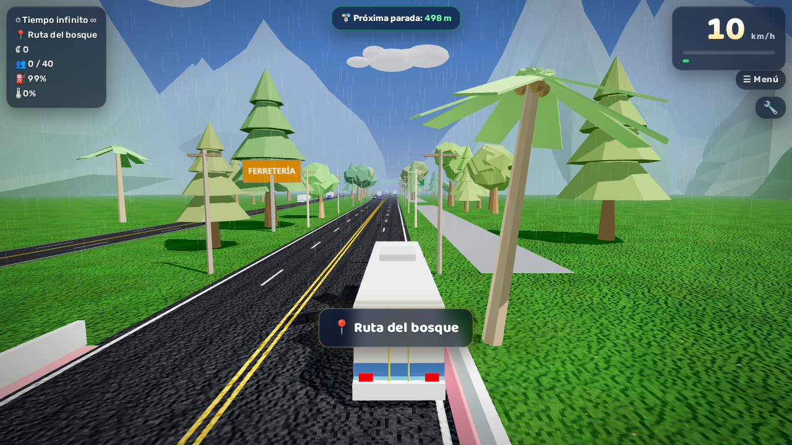

# 🚌 Autotransportes Desamparados 3D

A 3D bus game set in Costa Rica: drive the bus, stop at every green stop to pick up passengers, earn colones and dodge traffic. Along the way you pass the Rotonda de La Y Griega, the Zurquí tunnel, the Quick Pass toll, Estadio Nacional, the bus terminal and much more.

**▶ Play here:** https://aluiscard-develop.github.io/autotransportes-desamparados-3d/

The original game was created by my nephew 🧒. This version keeps all of his gameplay and only improves the graphics. You can also play the [original version](https://aluiscard-develop.github.io/autotransportes-desamparados-3d/original.html).

| Water track | Forest route in the rain |
|---|---|
|  |  |

## Controls

| Key | Action |
|---|---|
| Arrows / WASD | Drive |
| Space | Handbrake |
| C | Camera (exterior, driver, aisle, seat) |
| H | Horn |
| Shift / N | Nitro |
| R | Restart |
| M / Esc | Menu |
| 🔧 | Tuning and garage |

On mobile, on-screen buttons appear.

## What's in it

- 21 vehicles: 4 buses (ATD, Mercedes-Benz CAIO, Busscar Porvenir…), jeep, tank, F1, ultralight that flies, hovercraft, rocket and more
- 19 zones: urban center, highway, cable-stayed bridge, Zurquí tunnel, wooden bridge, Walmart roundabout with railway crossing, Bicentenario and Bandera roundabouts (at night), water track, race track and test track
- Tuning with 35 parts, a diesel engine with 6 gears and synthesized sound, fuel, engine heat and fire, rain

## Graphics improvements

- Sky with sun halo, warm horizon and stars at night
- Clouds with volume and shading
- Asphalt with lane lines, tire wear, cracks and patches
- Detailed grass texture with flowers
- Three kinds of trees (conifer, broadleaf and palm)
- Houses with doors, windows, base trim and varied roofs
- Mountains with relief, colors by height and snowy peaks
- Buildings whose windows light up at night or in the rain
- Traffic cars with real colors, tinted glass, headlights, bumpers and mirrors
- Animated water with waves
- Soft smoke and fire
- New interface: glass panels, speed bar, new fonts and menu
- Reflections switch off automatically if the device can't render them, so nothing shows up black

## Technical details

The game is a single `index.html` file that uses [Three.js r128](https://threejs.org/), with no build step. To play offline, open `index.html` in a browser. It needs an internet connection the first time to load Three.js and the fonts.
