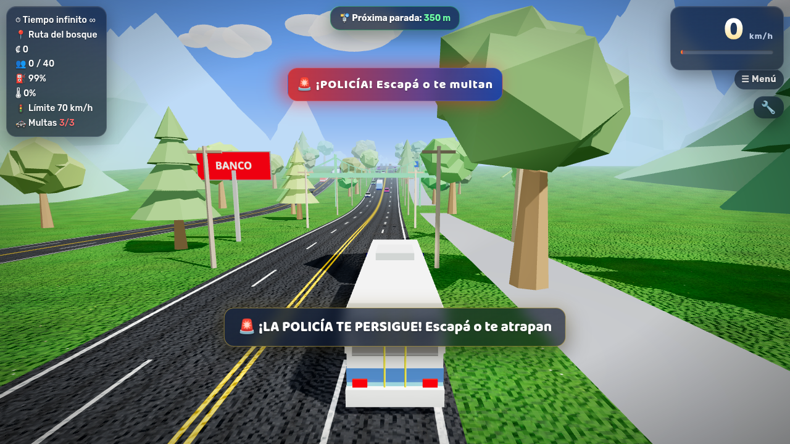
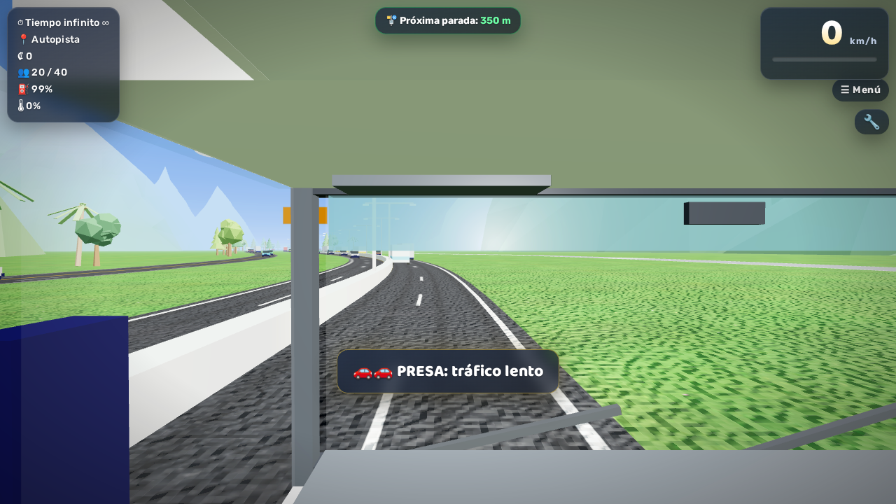
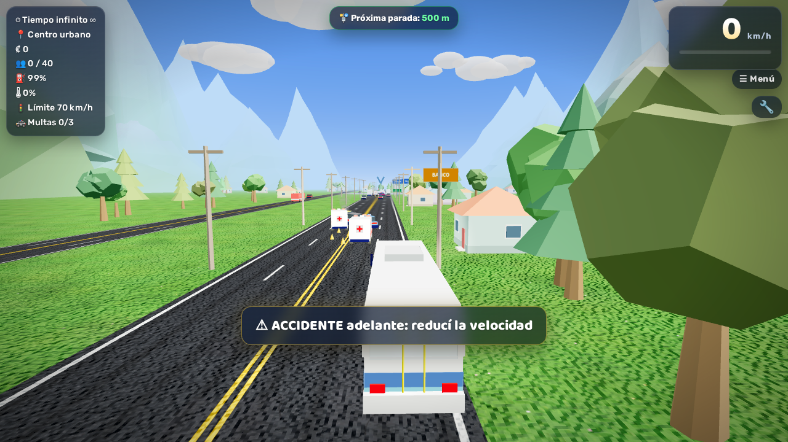
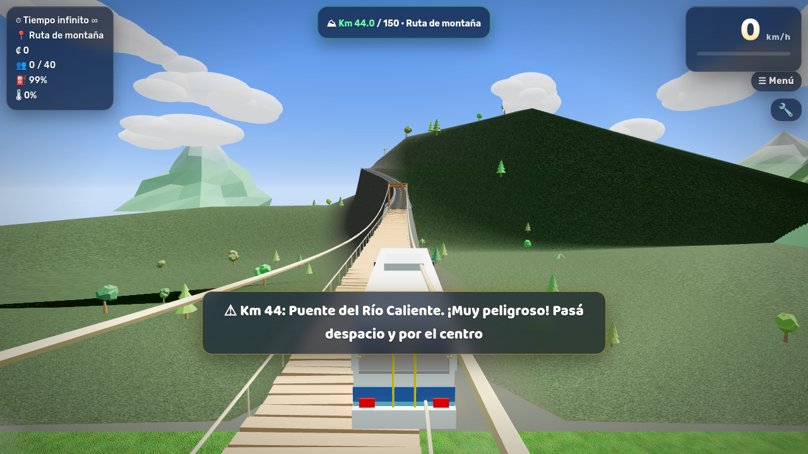
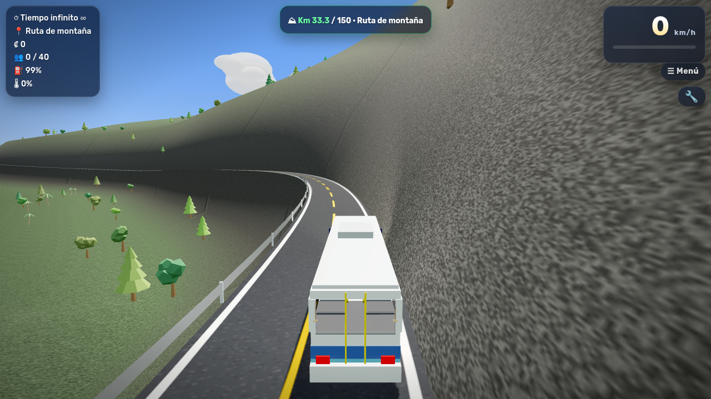
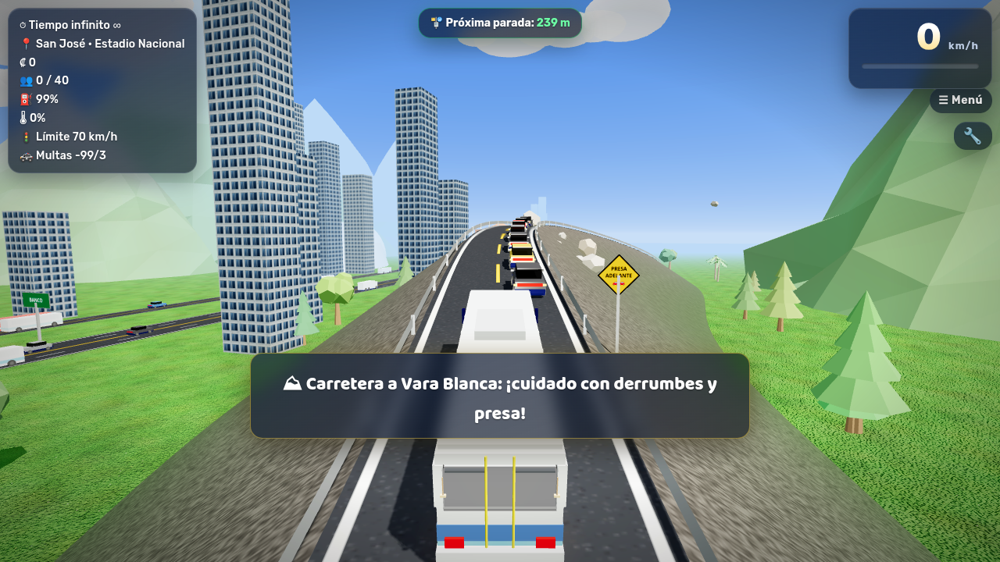
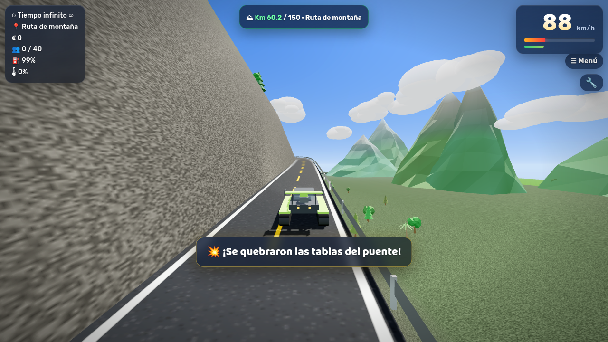
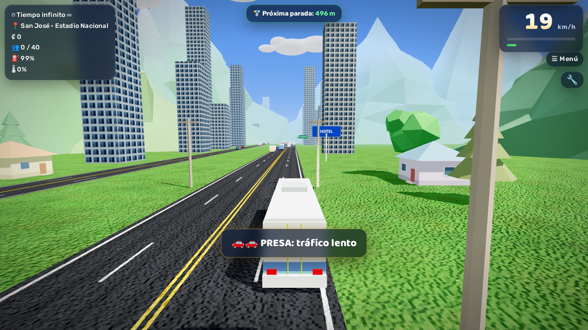
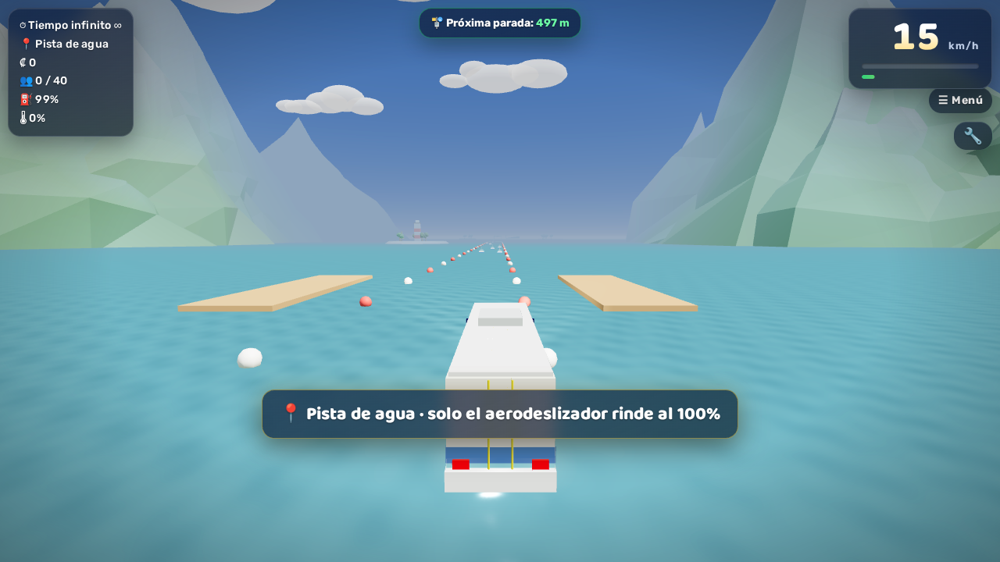

# 🚌 Autotransportes Desamparados 3D

Juego 3D de buses ambientado en Costa Rica: maneja el bus, frena en cada parada verde para subir pasajeros, gana colones y evita el tráfico. En el camino pasas por la Rotonda de La Y Griega, el Túnel Zurquí, el peaje Quick Pass, el Estadio Nacional, la terminal de buses y mucho más.

**▶ Juega aquí:** https://aluiscard-develop.github.io/autotransportes-desamparados-3d/

El juego original lo creó mi sobrino 🧒. Esta versión conserva toda su jugabilidad, mejora los gráficos y suma funciones nuevas. También puedes jugar la [versión original](https://aluiscard-develop.github.io/autotransportes-desamparados-3d/original.html).

**¿Quieres ayudar a mejorarlo?** Cualquier persona puede proponer cambios. Lee la [guía para colaborar](CONTRIBUTING.md).

| Desde la cabina | Ambulancia en un accidente |
|---|---|
|  |  |

| Puente del Río Caliente (km 44) | Precipicios en la Ruta de montaña |
|---|---|
|  |  |

| Carretera a Vara Blanca (presa y derrumbe) | 🐲 Oruga turbo todoterreno |
|---|---|
|  |  |

| Ciudad | Pista de agua |
|---|---|
|  |  |

## Controles

| Tecla | Acción |
|---|---|
| Flechas / WASD | Manejar |
| Espacio | Freno de mano |
| F | Echar agua (camión de bomberos) |
| C | Cámara (exterior, conductor, pasillo, asiento) |
| V (mantener) / 👀 | Mirar hacia atrás |
| H | Bocina |
| Shift / N | Nitro |
| R | Reiniciar |
| M / Esc | Menú |
| 🔧 | Tuning y garaje |

En celulares y tablets aparecen botones en la pantalla.

## Qué tiene

- **🆕 Lo más nuevo:**
  - **🌪 Apocalipsis en todo el juego** (se apaga en el menú: "🌪 Apocalipsis: No"): después de un rato de calma, **los carros empiezan a ir rapidísimo**, salen **tornados gigantes por todas partes** con carros volando, el clima se pone pésimo, hay explosiones y **gente corriendo y gritando**. Después llega la **🟣 Tormenta Morada**: cielo morado, rayos morados, tornados morados y bolas de fuego. Si sobrevivís: +₡15 000, y al rato vuelve a empezar.
  - **🏔 Avalancha gigantesca por todo el juego:** apenas empezás en cualquier zona te avisa que viene una avalancha 400 m detrás de vos, con nieve, carros, rocas, árboles y troncos. Te persigue siempre (arriba de la pantalla dice a cuántos metros está). Si te alcanza te daña mucho y vuelve a quedar 400 m atrás.
  - **👀 Mirar hacia atrás:** mantené **V** (o el botón 👀) y la cámara mira hacia atrás.
  - **🏔 Montañas nevadas (zona 43):** nieve que cae, pinos nevados, lago congelado con patinadores, telesilla, cabañas y muñecos de nieve. Fuera de la carretera la nieve frena a todos, menos a las motos de nieve.
  - **🏂 Motonieve Ultra 4x4:** cuatro orugas, jaula, barra de luces y escape doble; en la nieve no se atasca.
  - **▦ Mundo de Bloques (zona 44)**, **🧱 Ciudad de Juguete (zona 45)** y **🏁 Pista de Karts (zona 46)**, con flechas TURBO y cronómetro de SALIDA a META (entre más rápido, más plata). Son zonas originales, no copias de otros juegos.
  - **🏜 Desierto (zona 47):** dunas, mesetas rojas, cactus, oasis con camellos, plantas rodadoras, paneles solares y la última gasolinera.
  - **⛈ Supertormenta (zona 48), la más difícil:** lluvia fuerte y oscuridad, ráfagas de viento que te empujan, rayos (a veces te caen encima), un tornado que levanta carros y te tira por los aires, y casas en llamas. Si salís entero: +₡25 000.
  - **⛏ Autopista a Saratalán (zona 35):** a la orilla se construye la Carretera de las Minas (tierra, lastre, asfalto nuevo, pavimentadora, aplanadoras, planta de asfalto y pilas de un puente). Al final, el **Túnel Saratalán** atraviesa la cordillera.
  - **☠ Minas de Saratalán (zona 36):** cañón de roca roja, bocas de minas, rieles, camiones mineros gigantes y explosiones en la cantera. **Caen piedras que cruzan la carretera** y te dañan. Si salís vivo: +₡10 000.
  - **⛴ Ferry a Isla Bonita (zona 37):** subí el vehículo al ferry y frená: zarpa y te lleva con todo y vehículo a la isla (+₡3000). Si te metés al mar sin el ferry, volvés al muelle.
  - **🏝 Isla Bonita (zona 38):** playas a los dos lados, palmeras, sombrillas, hoteles, faro y un puente de regreso a tierra firme.
  - **🏙 Ciudad Esmeralda (zona 39), 🏔 Cordillera y valle (zona 40), 🛣 Autopistas del Pacífico (zona 41, con dos autopistas laterales que también se manejan y un paso elevado) y 🏖 Playas de Guanacaste (zona 42).**
  - **🚧 Obras en carretera por todo el juego:** conos, barreras, excavadoras, aplanadoras, mezcladoras, bandereros y trabajadores a la orilla.
  - **⚡ Oficinas del ICE y 📶 tiendas kölbi** por todo el juego, y **más carros** en el tráfico (SUV, deportivos, vans, camiones del ICE y de kölbi).
  - **🚧 Rotonda de La Y Griega en obras:** grúa torre que gira, excavadora, volqueta, conos y barreras en un carril de la rotonda, andamios junto a la Y y trabajadores. Por fuera hay **carriles externos** (uno por lado) para pasar directo sin dar la vuelta.
  - **🚏 Paradas remodeladas:** todas las paradas tienen caseta de vidrio, techo verde, pantalla con el próximo bus, banca y mapa de rutas. En la rotonda hay dos **estaciones remodeladas**: pará el bus en la franja verde del carril externo de la derecha (+₡2500).
  - **🚌 Terminal Autotransportes Lumaca (zona 32):** patio donde se puede entrar manejando, andenes techados con buses de Lumaca, boletería, pantalla de salidas y torre del reloj. Pará en el ANDÉN 1 (+₡8000).
  - **🤝 Países unidos (zonas 33 y 34):** Nicaragua, Honduras, El Salvador, Guatemala, México, Colombia, Venezuela, Brasil, Perú, Chile y Argentina, cada uno con su arco de bienvenida, banderas y monumento (catedral de León, Copán, El Salvador del Mundo, Tikal, Pirámide del Sol, Salto Ángel, Cristo Redentor, Machu Picchu, los Andes, el Obelisco…). Al entrar a cada país te sellan el pasaporte (+₡500).
  - **🏍 Motos para manejar** (deportiva y repartidora de Carl's Jr.) y **4 buses más** (Lumaca, escolar, turístico Pura Vida e internacional). También hay más buses de Lumaca en el tráfico.
  - **🛒 Walmart y 🍔 Carl's Jr.** a la orilla de la carretera por todo el juego.
- **31 vehículos (antes 25):** 🚛 **Super Diesel** (camión enorme con escapes de cromo que echan humo negro, llega a ~185 km/h y aplasta carros), 🚑 ambulancia y 🚒 camión de bomberos (con sirena, luces y sin límite de velocidad), 4 buses (ATD, Mercedes-Benz CAIO, Busscar Porvenir…), jeep, tanque, F1, un ultraligero que vuela, aerodeslizador, cohete y el nuevo **🐲 Oruga turbo**: todoterreno de orugas con alerón trasero y motor súper rápido (hasta ~245 km/h, casi no pierde velocidad fuera de la carretera)
- **32 zonas:** centro urbano, autopista, puente atirantado, Túnel Zurquí, puente de madera, Rotonda del Walmart con cruce de tren, rotondas del Bicentenario y de la Bandera (de noche), pista de agua, de carreras y de prueba, y las nuevas:
  - **🗽 Nueva York:** cuadras de rascacielos con calles, pantallas gigantes, tren elevado (metro) con dos estaciones, terminal de buses, estación de bomberos, hospital, la Estatua de la Libertad, una torre altísima con aguja, taxis amarillos y presa
  - **🏭 Parque industrial:** oficinas de Intel, AMD, Microsoft y Windows con sus parqueos, fábricas con chimenea, patio de contenedores, tráileres y un tren de carga
  - **🛂 Frontera · Migración:** casetas de Migración y Aduana, Duty Free, banderas y presa de tráileres. Si pasás despacio (máx 30 km/h) te sellan el pasaporte (+₡500); si pasás rápido, multa
  - **🛣 Autopista nueva:** la principal tiene presa, pero por la derecha sale una **autopista alterna sin presa** que vuelve a la principal al final
  - **🌎 Rotonda de las Naciones:** rotonda con banderas de 23 países y una avenida de banderas
  - **💀 Ruta de la Muerte (Cerro de la Muerte):** neblina espesa, lomas grandes, barandas de metal, cruces, avisos de peligro y antenas en la cima
  - **🔥 Autopista Florencio del Castillo · RECOPE:** a la orilla está el plantel de RECOPE con un **incendio gigantesco de 200 m de alto** que se ve desde lejos. Con el camión de bomberos y la tecla F lo podés apagar (tarda como 80 segundos) y ganás ₡50 000
  - **🏖 Puntarenas:** playa con sombrillas y palmeras, mar, muelle con un crucero, dos ferrys que van y vienen, botes y hoteles
  - **🌋 Parques nacionales:** volcanes Poás (con laguna), Turrialba, Arenal e Irazú echando humo, guardaparques, senderos y una catarata
  - **🏙 Chicago:** rascacielos, torres negras gigantes, el "frijol" de acero, el río con lanchas y el tren elevado
  - **❄ Minnesota:** nieve que cae, lagos congelados con casitas de pesca, pinos nevados, un mall gigante y la torre de agua
  - **⚓ Nueva Jersey:** peaje del Turnpike, puerto con grúas, barcos de carga y contenedores, refinería y Manhattan a lo lejos
  - **🇵🇦 Panamá:** el Canal de Panamá con esclusas y barcos que lo cruzan, rascacielos y la torre que se tuerce
- **Por todo el juego:** a la orilla de la carretera aparecen KFC, McDonald's, Dunkin', Burger King, Pizza Hut, Subway, Starbucks, Taco Bell, Wendy's, Pollo Campero, Popeyes, Domino's, estaciones de bomberos, hospitales, oficinas de Intel, AMD, Microsoft y Windows, y fábricas
- **Tráfico nuevo:** camiones de bomberos con luces, tráileres, motos, pickups, cisternas de combustible, mezcladoras, grúas, muchos más buses (escolares, articulados, de Nueva York y de rutas ticas) y más carros que antes
- **⛽ Gasolina infinita** en todos los vehículos, y **ya no se sobrecalientan**
- **🎁 La policía ya no multa: regala plata** cada vez que antes te habría multado
- **Nunca se pierde:** si chocás tanto que el vehículo se destroza, queda como nuevo y seguís manejando
- **🔥 Incendio gigante en la autopista (km 9, Circunvalación):** justo después de San José · Estadio Nacional. Hace una **presa de 5 km** (desde el peaje). En San José hay una **estación de bomberos** y un **hospital**, a 1 km del fuego.
  - **Carril de emergencia:** los carros se abren a los lados para dejar pasar a las ambulancias y a los bomberos (también a vos si manejás uno).
  - **🚒 Camión de bomberos:** acercate al fuego y mantené **F** (o el botón 💧) para echar agua. Es gigantesco: tarda como 35 segundos. Si lo apagás ganás ₡20 000 y la presa se empieza a mover. Los bomberos del tráfico también ayudan, pero más despacio.
  - **🚑 Ambulancia:** pará junto al incendio para subir 3 heridos y llevalos al hospital de San José (+₡15 000).
  - Si entrás al fuego con otro vehículo, te quemás.
- **Pendientes y bajadas** en la Autopista, la Ruta del bosque, la Circunvalación y el Cruce Río Frío: el bus se inclina, pierde velocidad al subir y agarra impulso al bajar
- **Carretera a Vara Blanca:** en San José · Estadio Nacional hay una salida a la derecha ("SALIDA · CARRETERA VARA BLANCA — CUIDADO DERRUMBES Y PRESA") que lleva a una carretera de montaña de 2 carriles. Sube con curvas hasta un paso de 24 m, tiene barandas, un derrumbe que tapa un carril, una presa de carros con las intermitentes y una piedra que rueda cerro abajo; hay que adelantar por el otro carril. Vuelve a la autopista antes del túnel.
- **Ruta de montaña a Vara Blanca (150 km):** se entra pasando la presa de la carretera a Vara Blanca, o desde el menú ("Inicio: Ruta de montaña"). Tiene curvas y muchísimas subidas y bajadas, paredes de roca y **precipicios** (algunos sin baranda: si te salís, caés), bosques de parques nacionales (Braulio Carrillo, Volcán Poás, Tapantí, Volcán Irazú, Juan Castro Blanco y Volcán Arenal), miradores con **volcanes** (Poás con su laguna, Barva, Irazú, Turrialba y Arenal echando humo), bombas de gasolina cada 10 km y rótulos de kilómetro. Al llegar al km 150 ganás ₡50 000 y bajás de vuelta a la autopista.
- **Km 44 · Puente del Río Caliente:** puente colgante de madera, angosto, sin barandas sólidas, con tablas que faltan y que se mece. Hay que pasar despacio (máx. 20 km/h) y por el centro: si vas rápido cruje y te daña, a más de 75 km/h se quiebran las tablas y si te salís del borde caés al río (que echa vapor).
- ~~Multas y policía~~ (ahora la policía regala plata): te multan por exceso de velocidad (70 km/h en ciudad, 100 en autopista), por chocar y por pasarte la parada. Con 3 multas te persigue una patrulla con sirena; si te alcanza, pagas ₡5000. Si le sacas más de 320 m, te escapas.
- **Ambulancias** en el tráfico (más rápidas, con luces) y atendiendo los accidentes
- **Parabrisas real:** desde la cámara del conductor se ve la carretera, con limpiaparabrisas, tablero y retrovisor
- Tuning con 35 piezas, motor diésel de 6 cambios con sonido sintetizado y lluvia

## Mejoras gráficas

Cielo con halo del sol y estrellas de noche · nubes con volumen · asfalto con carriles, desgaste y grietas · zacate detallado · árboles de 3 tipos (pino, frondoso y palmera) · casas con puertas y ventanas · montañas con relieve y cumbres nevadas (sin meterse en la carretera) · ventanas de edificios que se encienden de noche · carros con vidrios polarizados y focos · agua con oleaje · humo y fuego suaves · interfaz nueva.

En celulares y tablets los reflejos se apagan solos. Así la carretera y el bus nunca se ven negros ni sin color.

## Cómo está hecho

| Archivo | Qué contiene |
|---|---|
| [index.html](index.html) | Pantallas y botones (menú, panel, controles táctiles) |
| [css/estilos.css](css/estilos.css) | Colores y estilos de la interfaz |
| [js/juego.js](js/juego.js) | El juego (mundo 3D, vehículos, tráfico, física, sonido, multas) |
| [js/apocalipsis.js](js/apocalipsis.js) | El apocalipsis: tornados, carros rapidísimos, gente corriendo y la Tormenta Morada (`FASES`, `VEL_CARROS`) |
| [js/avalancha.js](js/avalancha.js) | La avalancha que te persigue (`AVALANCHA`: distancia, velocidad) |
| [js/mundo5.js](js/mundo5.js) | Las zonas 43 a 48 (montañas nevadas, Mundo de Bloques, Ciudad de Juguete, Pista de Karts, desierto y Supertormenta) y la Motonieve Ultra 4x4 |
| [js/mundo4.js](js/mundo4.js) | Las zonas 35 a 42 (Carretera de las Minas, Túnel y Minas de Saratalán, ferry, Isla Bonita, Ciudad Esmeralda, cordillera, autopistas y playas), las obras en carretera, el ICE, kölbi y los carros nuevos |
| [js/mundo3.js](js/mundo3.js) | Las zonas 32 a 34 (Terminal Lumaca y Países unidos), la Rotonda de La Y Griega en obras con sus carriles externos, Walmart, Carl's Jr., las motos y los buses nuevos |
| [js/mundo2.js](js/mundo2.js) | Las zonas 24 a 31 (Ruta de la Muerte, RECOPE, Puntarenas, volcanes, Chicago, Minnesota, Nueva Jersey, Panamá), el Super Diesel y más tráfico |
| [js/mundo.js](js/mundo.js) | Las zonas 19 a 23, los negocios de la orilla (restaurantes, bomberos, hospitales, oficinas) y los vehículos nuevos |
| [original.html](original.html) | La versión original, sin tocar |

El juego usa [Three.js r128](https://threejs.org/) y no necesita instalar ni compilar nada. Para jugar sin internet, abre `index.html` en el navegador (la primera vez sí necesita conexión para cargar Three.js y las fuentes).

## Rendimiento

- Las piezas que desaparecen (carros, paradas, patrullas) liberan la memoria de la tarjeta gráfica, así que el juego ya no se pone lento con el tiempo.
- La interfaz solo se redibuja cuando algo cambia.
- El escenario que no se mueve no se recalcula en cada cuadro.
- Los carros comparten la misma pintura por color.
- Cada carro, negocio y escenario nuevo se junta en pocas piezas (una por material), así la tarjeta gráfica dibuja menos cosas por cuadro.
