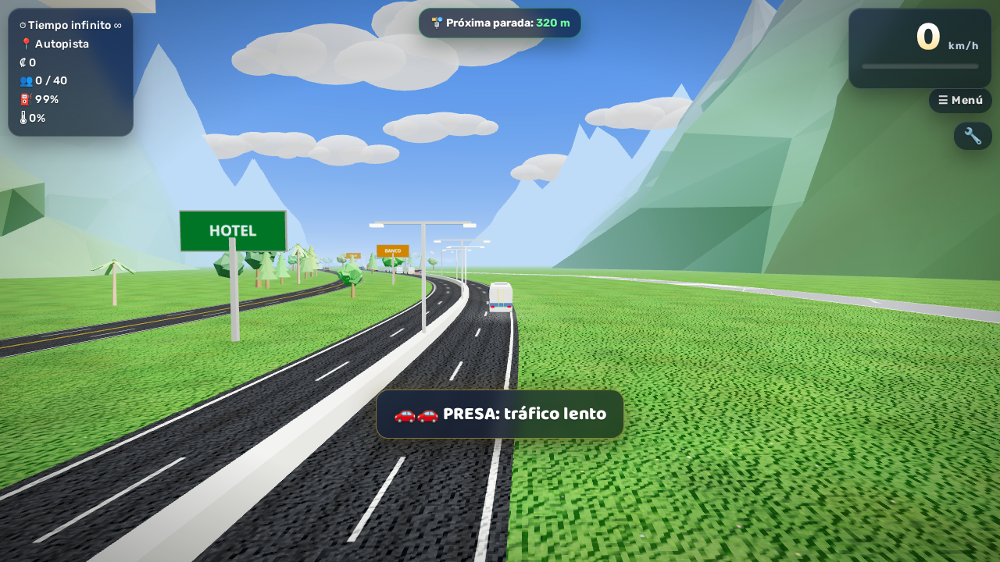

# 🚌 Autotransportes Desamparados 3D

Juego 3D de buses ambientado en Costa Rica: maneja el bus, frena en cada parada verde para subir pasajeros, gana colones y evita el tráfico. En el camino pasas por la Rotonda de La Y Griega, el Túnel Zurquí, el peaje Quick Pass, el Estadio Nacional, la terminal de buses y mucho más.

**▶ Juega aquí:** https://aluiscard-develop.github.io/autotransportes-desamparados-3d/

El juego original lo creó mi sobrino 🧒. Esta versión conserva toda su jugabilidad, mejora los gráficos y suma funciones nuevas. También puedes jugar la [versión original](https://aluiscard-develop.github.io/autotransportes-desamparados-3d/original.html).

**¿Quieres ayudar a mejorarlo?** Cualquier persona puede proponer cambios. Lee la [guía para colaborar](CONTRIBUTING.md).

| Desde la cabina | Ambulancia en un accidente |
|---|---|
|  |  |

| Ciudad | Pista de agua |
|---|---|
|  |  |

## Controles

| Tecla | Acción |
|---|---|
| Flechas / WASD | Manejar |
| Espacio | Freno de mano |
| C | Cámara (exterior, conductor, pasillo, asiento) |
| H | Bocina |
| Shift / N | Nitro |
| R | Reiniciar |
| M / Esc | Menú |
| 🔧 | Tuning y garaje |

En celulares y tablets aparecen botones en la pantalla.

## Qué tiene

- **21 vehículos:** 4 buses (ATD, Mercedes-Benz CAIO, Busscar Porvenir…), jeep, tanque, F1, un ultraligero que vuela, aerodeslizador, cohete y más
- **19 zonas:** centro urbano, autopista, puente atirantado, Túnel Zurquí, puente de madera, Rotonda del Walmart con cruce de tren, rotondas del Bicentenario y de la Bandera (de noche), pista de agua, de carreras y de prueba
- **Autopistas con curvas** (Autopista, Peaje y Circunvalación): si no giras, el bus se sale hacia afuera
- **Multas y policía:** te multan por exceso de velocidad (70 km/h en ciudad, 100 en autopista), por chocar y por pasarte la parada. Con 3 multas te persigue una patrulla con sirena; si te alcanza, pagas ₡5000. Si le sacas más de 320 m, te escapas.
- **Ambulancias** en el tráfico (más rápidas, con luces) y atendiendo los accidentes
- **Parabrisas real:** desde la cámara del conductor se ve la carretera, con limpiaparabrisas, tablero y retrovisor
- Tuning con 35 piezas, motor diésel de 6 cambios con sonido sintetizado, gasolina, calentamiento e incendio del motor, y lluvia

## Mejoras gráficas

Cielo con halo del sol y estrellas de noche · nubes con volumen · asfalto con carriles, desgaste y grietas · zacate detallado · árboles de 3 tipos (pino, frondoso y palmera) · casas con puertas y ventanas · montañas con relieve y cumbres nevadas (sin meterse en la carretera) · ventanas de edificios que se encienden de noche · carros con vidrios polarizados y focos · agua con oleaje · humo y fuego suaves · interfaz nueva.

En celulares y tablets los reflejos se apagan solos. Así la carretera y el bus nunca se ven negros ni sin color.

## Cómo está hecho

| Archivo | Qué contiene |
|---|---|
| [index.html](index.html) | Pantallas y botones (menú, panel, controles táctiles) |
| [css/estilos.css](css/estilos.css) | Colores y estilos de la interfaz |
| [js/juego.js](js/juego.js) | Todo el juego (mundo 3D, vehículos, tráfico, física, sonido, multas) |
| [original.html](original.html) | La versión original, sin tocar |

El juego usa [Three.js r128](https://threejs.org/) y no necesita instalar ni compilar nada. Para jugar sin internet, abre `index.html` en el navegador (la primera vez sí necesita conexión para cargar Three.js y las fuentes).

## Rendimiento

- Las piezas que desaparecen (carros, paradas, patrullas) liberan la memoria de la tarjeta gráfica, así que el juego ya no se pone lento con el tiempo.
- La interfaz solo se redibuja cuando algo cambia.
- El escenario que no se mueve no se recalcula en cada cuadro.
- Los carros comparten la misma pintura por color.
